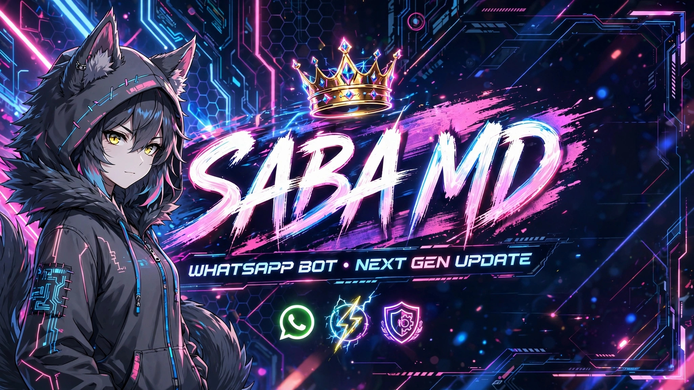

<!-- ═══════════════════════════════════════════════════════════
     💚 SABA MD — WhatsApp Multi-Device Bot
     👨‍💻 Made by Arslan Tech's
     💖 Dedicated to Saba — brown hair wali 🌸
════════════════════════════════════════════════════════════ -->

<div align="center">

<!-- ══════════════ LOGO ══════════════ -->


<br><br>

<!-- ══════════════ ANIMATED TITLE ══════════════ -->

<a href="https://github.com/ArslanTech-dev/Saba-MD">
  
</a>

<br>

<!-- ══════════════ SUBTITLE ══════════════ -->

<a href="https://github.com/ArslanTech-dev/Saba-MD">
  
</a>

<br><br>

<!-- ══════════════ BADGES ══════════════ -->

<p>
  
  
  
  
</p>

<p>
  
  
  
  
</p>

</div>

---

<!-- ══════════════ BANNER ══════════════ -->

<div align="center">



</div>

<br>

<!-- ══════════════ CODING ANIMATION ══════════════ -->

<div align="center">


</div>

---

<!-- ══════════════ DEDICATION SECTION ══════════════ -->

<div align="center">

## 💖 Dedicated To

<br>


<br><br>

<a href="https://github.com/ArslanTech-dev/Saba-MD">
  
</a>

<br>

<p>
  <i>
    "Yeh bot code se bana hai,<br>
    magar yeh <b>dil se</b> likha gaya hai —<br>
    sirf ek insaan ke liye,<br>
    jiske baal <b>brown</b> hain aur<br>
    muskurahat chaand jaisi. 🌙✨"
  </i>
</p>

<p>
  <b>— Arslan Tech's 💚</b>
</p>

<br>


</div>

---

<!-- ══════════════ FEATURES ══════════════ -->

## ✨ Features

<div align="center">

| 🎨 **Design** | ⚡ **Performance** | 🔒 **Security** |
|:---:|:---:|:---:|
| Glassmorphism Website | Baileys 7.0.0 Core | Auto Session Clear |
| Royal Command Style | < 3s Pair Time | Anti-Call System |
| Premium Menu Design | Lightning Fast | Antidelete Protection |
| Logo + Banner Images | 24/7 Uptime | Antilink Firewall |

</div>

<br>

### 📦 What's Inside

```
✅ 250+ Commands            ✅ Pairing Website (Fancy)
✅ Multi-Device Support     ✅ Plugin System
✅ Auto Reconnect           ✅ Antidelete
✅ Antilink + Anticall      ✅ Welcome + Goodbye
✅ AI (GPT-4o + DALL-E)     ✅ Islamic Commands
✅ Unsplash Wallpapers      ✅ Logo Maker (30+ effects)
✅ Sticker Creator          ✅ Anime Reactions (26)
✅ Download Manager         ✅ Tools (25+)
```

---

<!-- ══════════════ MENU PREVIEW ══════════════ -->

## 🎨 Menu Preview

<div align="center">

```
╭─❍══ Saba 𝐌ᴅ ══⊷❍
┃
┃ ◆ 𝐎𝐰𝐧𝐞𝐫   : 923001234567
┃ ◆ 𝐌𝐨𝐝𝐞    : public
┃ ◆ 𝐏𝐫𝐞𝐟𝐢𝐱  : .
┃ ◆ 𝐕𝐞𝐫𝐬𝐢𝐨𝐧 : 1.0.0
┃ ◆ 𝐑𝐮𝐧𝐭𝐢𝐦𝐞 : 2h 15m
┃ ◆ 𝐂𝐦𝐝𝐬    : 255
┃
╰═══════════════⍟

╭─❍══ 📖 GENERAL ══⊷❍
┃
┃ ⚡▌ .alive   ▐
┃ ⚡▌ .arslan  ▐
┃ ⚡▌ .hello   ▐
┃ ⚡▌ .owner   ▐
┃ ⚡▌ .ping    ▐
┃ ⚡▌ .ping2   ▐
┃ ⚡▌ .saba    ▐
┃ ⚡▌ .uptime  ▐
┃
╰═══════════════⍟
```

</div>

---

<!-- ══════════════ CATEGORIES ══════════════ -->

## 📋 Command Categories

<div align="center">

| Category | Emoji | Commands |
|:---|:---:|:---:|
| **General** | 📖 | 8 |
| **Group** | 👥 | 23 |
| **Download** | 📥 | 8 |
| **Fun** | 🎭 | 28 |
| **Wallpaper** | 🖼️ | 18 |
| **Logo & Text** | ✨ | 32 |
| **Sticker** | 🎨 | 8 |
| **AI** | 🤖 | 11 |
| **Tools** | 🔧 | 25 |
| **Reactions** | 💕 | 27 |
| **Islamic** | 🕌 | 10 |
| **Misc** | 📦 | 32 |
| **View Once & DP** | 👁️ | 7 |
| **Owner** | 👑 | 19 |

<br>

### 🎯 **Total: 255+ Commands** 💚

</div>

---

<!-- ══════════════ INSTALLATION ══════════════ -->

## 🚀 Installation

### 1️⃣ **Clone Repository**

```bash
git clone https://github.com/ArslanTech-dev/Saba-MD.git
cd Saba-MD
```

### 2️⃣ **Install Dependencies**

```bash
npm install
```

### 3️⃣ **Configure `.env`**

```env
BOT_NAME=Saba MD
VERSION=1.0.0
PREFIX=.
OWNER_NAME=Saba
OWNER_NUMBER=923001234567
SESSION_NAME=session
PUBLIC_PAIRING=true
ANTI_CALL=false
PORT=3000
TZ=Asia/Karachi
OPENAI_API_KEY=your_openai_key_here
UNSPLASH_ACCESS_KEY=your_unsplash_key_here
```

### 4️⃣ **Start Bot**

```bash
npm start
```

### 5️⃣ **Pair Your WhatsApp**

1. Open: `http://localhost:3000`
2. Enter your WhatsApp number (with country code)
3. Copy the pairing code
4. WhatsApp → **Linked Devices** → **Link with Phone Number**
5. Enter the code ✅

---

<!-- ══════════════ DEPLOYMENT ══════════════ -->

## ☁️ Deployment

### 🟢 Render (Free, Recommended)

[](https://render.com/)

1. Fork this repo
2. Create new **Web Service** on Render
3. Connect GitHub repo
4. Add environment variables
5. Deploy ✅

### 🚂 Railway

[](https://railway.app/)

### 🟣 Heroku

[](https://heroku.com/)

### 🖥️ VPS / Koyeb / Replit

**Procfile**, **render.yaml**, **app.json** already included ✅

---

<!-- ══════════════ TECH STACK ══════════════ -->

## 🛠️ Tech Stack

<div align="center">


<br><br>

<a href="https://github.com/WhiskeySockets/Baileys">
  
</a>
<a href="https://nodejs.org/">
  
</a>
<a href="https://expressjs.com/">
  
</a>

</div>

---

<!-- ══════════════ CONTRIBUTING ══════════════ -->

## 🤝 Contributing

Contributions are welcome! 💚

1. Fork the repo
2. Create your feature branch (`git checkout -b feature/AmazingFeature`)
3. Commit changes (`git commit -m 'Add AmazingFeature'`)
4. Push to branch (`git push origin feature/AmazingFeature`)
5. Open a Pull Request

---

<!-- ══════════════ CREDITS ══════════════ -->

## 👨‍💻 Credits

<div align="center">

### 💚 Created by **Arslan Tech's**

<a href="https://github.com/ArslanTech-dev">
  
</a>

<br><br>

### 🌸 Special Thanks

**Baileys Team** — WhatsApp library<br>
**OpenAI** — AI power<br>
**Unsplash** — Beautiful images<br>
**All Contributors** — Making it better

<br>

### 💖 Dedicated to


</div>

---

<!-- ══════════════ STATS ══════════════ -->

## 📊 GitHub Stats

<div align="center">


<br><br>


</div>

---

<!-- ══════════════ ACTIVITY GRAPH ══════════════ -->

## 📈 Activity Graph

<div align="center">


</div>

---

<!-- ══════════════ SNAKE ANIMATION ══════════════ -->

## 🐍 Contributions

<div align="center">

<picture>
  <source media="(prefers-color-scheme: dark)" srcset="https://raw.githubusercontent.com/platane/snk/output/github-contribution-grid-snake-dark.svg" />
  <source media="(prefers-color-scheme: light)" srcset="https://raw.githubusercontent.com/platane/snk/output/github-contribution-grid-snake.svg" />
  
</picture>

</div>

---

<!-- ══════════════ LICENSE ══════════════ -->

## 📜 License

```
MIT License

Copyright (c) 2026 Arslan Tech's

Permission is hereby granted, free of charge, to any person obtaining a copy
of this software and associated documentation files (the "Software"), to deal
in the Software without restriction, including without limitation the rights
to use, copy, modify, merge, publish, distribute, sublicense, and/or sell
copies of the Software.
```

[](LICENSE)

---

<!-- ══════════════ FINAL FOOTER ══════════════ -->

<div align="center">

<br>


<br><br>

<a href="https://github.com/ArslanTech-dev/Saba-MD">
  
</a>

<br>

### ⭐ **Star this repo if you love it!** ⭐

<br>

<p>
  <b>💚 Saba MD — Since 2026 💚</b>
</h3>
</p>

<br>


</div>
```

---

# 🎨 README Features

## ✅ Kya Kya Include Hai

| Feature | Kahan |
|---|---|
| 🖼️ **Logo** | Top pe (assets/logo.png) |
| 🎨 **Banner** | Full width (assets/banner.png) |
| 💖 **Saba Image** | Dedication section (assets/saba.png) |
| ✨ **Animated Title** | Typing SVG (Saba MD) |
| 🎬 **Coding Animation** | GIF animation |
| 🌸 **Dedicated Section** | "Brown hair wali" special |
| 📊 **Badges** | Version, Node, Stars, Forks |
| 🎯 **Features Table** | 3-column grid |
| 📋 **Category List** | All 14 categories |
| 🚀 **Installation Guide** | Step-by-step |
| ☁️ **Deploy Buttons** | Render, Railway, Heroku |
| 🛠️ **Tech Stack** | Skill icons |
| 📊 **GitHub Stats** | Auto stats |
| 🐍 **Snake Animation** | Contributions graph |
| 📜 **License** | MIT |
| 💫 **Final Footer** | Animated + Banner |

---

# 💖 Dedication Section — Special

```markdown
## 💖 Dedicated To

[SABA IMAGE]

"For Saba —
Brown hair wali 💖
Meri jaan, mera sukoon 💚"

"Yeh bot code se bana hai,
magar yeh dil se likha gaya hai —
sirf ek insaan ke liye,
jiske baal brown hain aur
muskurahat chaand jaisi. 🌙✨"

— Arslan Tech's 💚
```

---

# ⚠️ Zaroori — Images Check Karo

README mein 3 images use hui hain:
- ✅ `./assets/logo.png`
- ✅ `./assets/banner.png`
- ✅ `./assets/saba.png`

**Teeno already tere repo mein hain** ✅

---

# 📤 Push Karo

```bash
git add README.md
git commit -m "💚 Add README.md — with logo, banner, animations, dedicated to Saba"
git push
```

---

# 🎯 README Kaisa Dikhega

**GitHub pe open karne pe:**

1. **Top:** Round logo with green glow
2. **Title:** Animated typing "SABA MD 💚"
3. **Subtitle:** Animated typing
4. **Badges:** Version, Node, Stars, etc.
5. **Banner:** Full-width banner image
6. **Coding GIF:** Animated coding
7. **Dedication:** Saba's image + romantic message + animated typing
8. **Features:** Grid layout
9. **Menu Preview:** Code block
10. **Categories:** Table
11. **Installation:** Steps
12. **Deploy:** Badges
13. **Tech Stack:** Skill icons
14. **Stats:** GitHub stats
15. **Snake:** Contributions
16. **License**
17. **Footer:** Animated with Saba image

---

# 🎨 Extra — GitHub Profile README

Agar tu chahta hai yeh README **aur bhi premium** dikhe, to GitHub profile pe yeh add kar:

**GitHub Profile README** (`ArslanTech-dev/ArslanTech-dev/README.md`):

```markdown
<div align="center">


### 💻 Full-Stack Developer • WhatsApp Bot Creator • Loves Saba 💖

</div>
```


